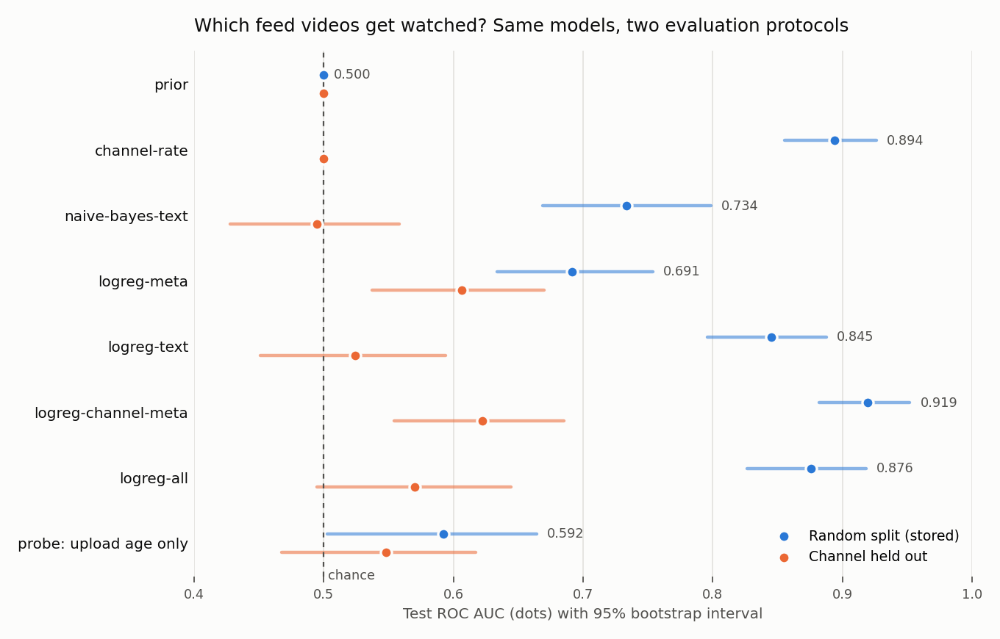

# YouTube Watch Predictor

**Which videos in your feed will you actually watch?** This repo turns a YouTube activity export into a clean, labeled benchmark, trains seven baseline classifiers on it, and scores them under two evaluation protocols with bootstrap confidence intervals. Everything runs offline on the Python standard library: no API keys, no network calls, no `pip install`.

I built it on a private export of my own YouTube activity (8,206 videos across 1,088 channels). The data stays private; the code, the methodology and the aggregate results are here, along with a synthetic data generator so you can run the whole pipeline in under ten seconds.



## Results

Test split of the 10:1 evaluation set (836 videos, 76 watched). Thresholds tuned for F1 on validation; intervals are 1,000-sample bootstrap 95% CIs. Full numbers in [`reports/results.json`](reports/results.json).

| Model | Features | ROC AUC, random split | ROC AUC, channel held out | Avg precision (random) | F1 (random) |
|---|---|---|---|---|---|
| prior | none | 0.500 | 0.500 | 0.091 | 0.167 |
| channel-rate | channel | 0.894 (0.855-0.926) | 0.500 | 0.497 | 0.536 |
| naive-bayes-text | title + description | 0.734 (0.669-0.799) | 0.495 | 0.328 | 0.342 |
| logreg-meta | views, likes, duration | 0.691 (0.634-0.754) | 0.606 | 0.250 | 0.198 |
| logreg-text | title + description | 0.845 (0.796-0.888) | 0.524 | 0.430 | 0.416 |
| **logreg-channel-meta** | channel + metadata | **0.919 (0.882-0.952)** | **0.622** | **0.610** | **0.621** |
| logreg-all | channel + metadata + text | 0.876 (0.827-0.918) | 0.570 | 0.517 | 0.421 |
| *probe: upload age only* | days since upload | 0.592 | 0.548 | 0.124 | 0.238 |

What the numbers say:

- **Taste is mostly channel loyalty.** A one-line smoothed per-channel watch rate reaches 0.894 AUC. Logistic regression over channel identity plus popularity and length gets to **0.919 AUC and 0.61 average precision**, 6.7x the 0.091 base rate.
- **The channel-holdout protocol shows where that comes from.** Hash every channel into exactly one split and the same models fall to 0.50-0.62. Text features that looked strong (0.845) were mostly recognizing channels by their titles. Popularity and duration carry the signal that transfers to brand-new channels.
- **Leakage is measured, not guessed.** Watches accumulate over months while feed candidates are scraped on collection day, so upload age separates the classes for reasons that have nothing to do with taste. On its own it scores 0.59 AUC, which is why it is reported as a probe and kept out of every model.

## Quickstart

Python 3.9+ and nothing else.

```bash
python3 make_synthetic.py                    # fabricated export -> data/sample/inputs.json.gz
python3 build_dataset.py --inputs data/sample/inputs.json.gz --output-dir data/sample
python3 benchmark.py --dataset data/sample/evaluation_10to1.csv.gz
python3 -m unittest discover -s tests -v
```

`benchmark.py` prints a markdown table like the one above (with synthetic numbers) in about three seconds. Add `--output reports/results.json`, then `python3 scripts/plot_results.py reports/results.json docs/results.png` (needs matplotlib) to redraw the chart.

Score your own model with the standalone evaluator. It wants a `video_id,score` CSV covering exactly the videos in the chosen split:

```bash
python3 evaluate.py --dataset data/sample/evaluation_10to1.csv.gz --split test \
  --predictions predictions.csv --threshold 0.5 --output reports/my_model.json
```

## How it works

```
activity export ──► build_dataset.py ──► all_available.csv.gz      every eligible video
(history, feeds,     labels, dedup,      evaluation_10to1.csv.gz   exact 10:1 subset, stratified splits
 Watch Later,        Shorts filter,      dataset_report.json       counts, checksums, label notes
 progress,           splits
 metadata)                                        │
                                                  ▼
                                    benchmark.py ── fit on train, tune threshold on validation,
                                                    score test once, bootstrap CIs, two protocols
                                    evaluate.py  ── metrics for any external model's predictions
```

**Labels.** A positive is a recorded, non-Short watch. A negative is a video that appeared in the Home or Subscriptions feed and never shows up anywhere in the collected history, including progress bars and "WATCHED" badges. Shorts and unknown-format watches are dropped using explicit format markers from the export, not a duration guess.

**Splits.** The builder writes label-stratified, video-disjoint train/validation/test splits (80/10/10), and the 10:1 subset keeps that exact ratio inside every split. `benchmark.py --protocol channel-holdout` re-splits by a stable CRC32 of `channel_id`, so no test channel is ever seen in training.

**Models.** All seven are written from scratch in [`benchmark.py`](benchmark.py): a constant prior, a Beta-smoothed channel watch rate, multinomial naive Bayes over title and description word sets, and L2-regularized logistic regression trained with Adagrad on sparse features (log views, log likes, like rate, log duration with bucketed indicators, channel one-hot, title and description tokens).

**Metrics.** [`evaluate.py`](evaluate.py) computes confusion counts, accuracy, precision, recall, specificity, balanced accuracy, F1, tie-aware ROC AUC, average precision and Brier score, and rejects duplicate, missing, extra or non-probability predictions.

**Reproducibility.** Fixed seeds, fixed input ordering and gzip with a zeroed timestamp: the same export produces byte-identical CSVs, and the build report records SHA-256 checksums for inputs and outputs.

More detail in [`docs/methodology.md`](docs/methodology.md).

## Bring your own export

`build_dataset.py` reads one gzipped JSON file with five sections: watch `history`, `watch_later`, `feeds` (cards seen on Home and Subscriptions), `progress` observations and per-video `metadata` in YouTube Data API `videos.list` shape. [`docs/data-format.md`](docs/data-format.md) documents every field, and `make_synthetic.py` is a working example of a producer. The output CSV columns are documented there too.

## Project layout

| Path | What it does |
|---|---|
| `build_dataset.py` | Export to labeled CSVs, splits and a dataset report |
| `benchmark.py` | Feature extraction, seven baselines, two protocols, bootstrap CIs |
| `evaluate.py` | Standalone scorer for `video_id,score` predictions |
| `make_synthetic.py` | Fabricated export with a hidden viewer profile |
| `scripts/plot_results.py` | Results chart (optional matplotlib) |
| `reports/results.json` | Aggregate results from the private export |
| `tests/` | Unit tests plus an end-to-end pipeline test on synthetic data |

## Tech

Python standard library only (`csv`, `gzip`, `json`, `random`, `math`). Ruff for lint, `unittest` for tests, GitHub Actions on Python 3.10, 3.12 and 3.13.

---

Built by [Joey Hersh](https://github.com/joey12725). MIT licensed.
